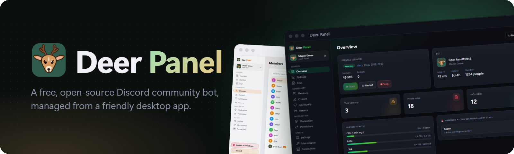
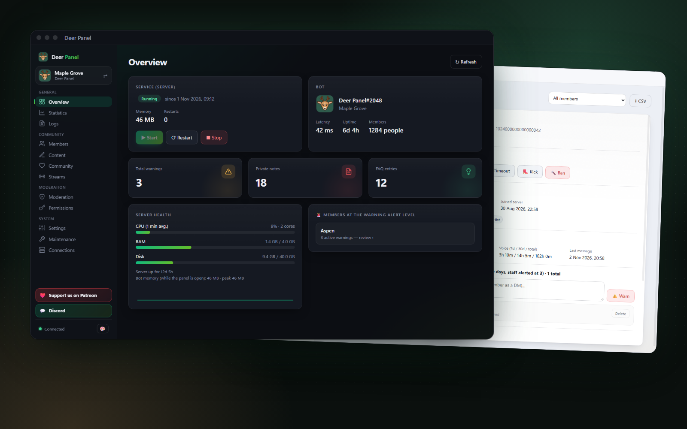
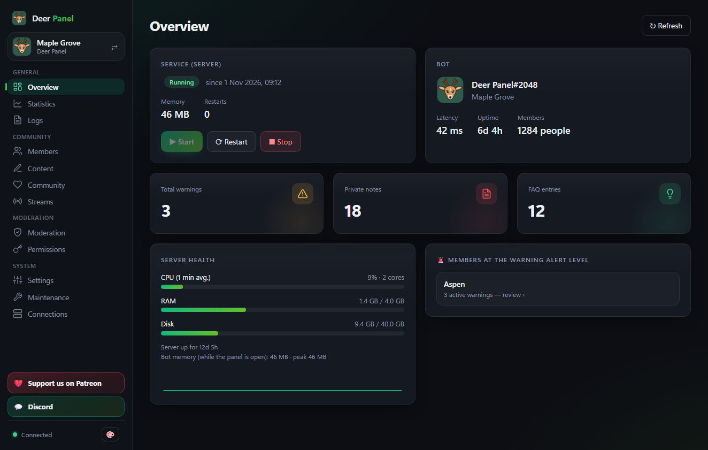
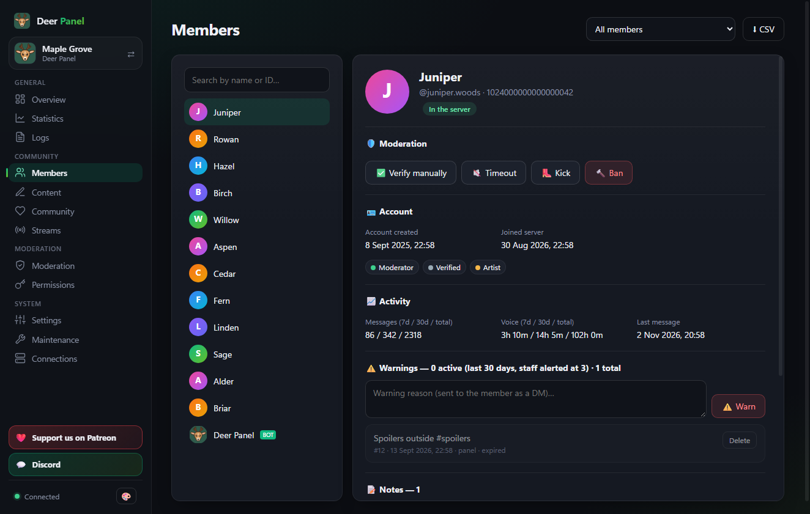
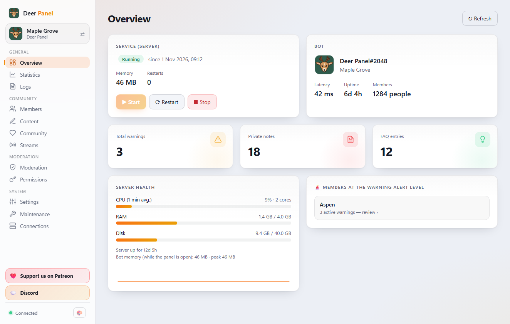
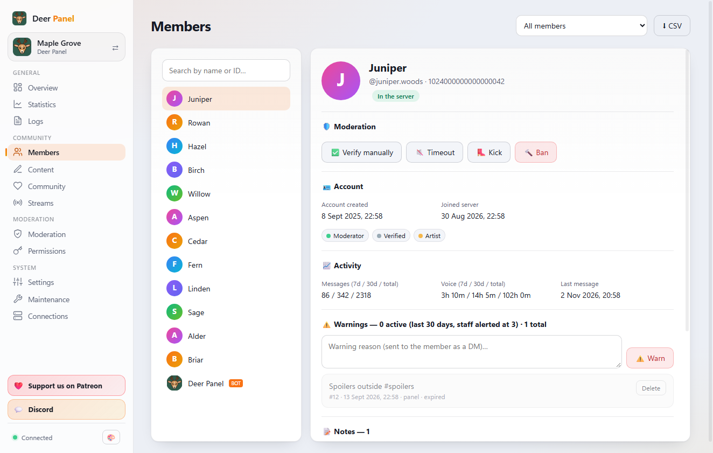

<p align="center">
  
</p>

# Deer Panel

<p>
  <a href="https://discord.gg/hucz7bACBc"></a>
  <a href="https://www.patreon.com/cw/DeerPanel/membership"></a>
  <a href="LICENSE"></a>
</p>

**Deer Panel** is a free Windows desktop app plus a Discord bot (discord.js v14) for running a
community server. You run your own bot with your own token, on your own computer or on a Linux
server, and manage everything from the panel: members, moderation, welcome and verification,
role panels, FAQ, showcase, stream alerts and the bot itself. The bot and the panel speak English and
Turkish.

<p align="center">
  
</p>

## ✨ Features

**Bot**
- **Members:** welcome messages, auto-role (waits for Rules Screening), verification button with
  minimum account age, button self-role panel.
- **Moderation:** warnings with staff alerts, mod log (joins, leaves, deleted/edited messages,
  bans, kicks, timeouts), AutoMod blocks counted as warnings, private owner notes.
- **Community:** message and voice leaderboards, a picture showcase with a weekly winner, FAQ,
  say and poll messages from the panel, rule messages.
- **Stream alerts:** Twitch, Kick and YouTube.
- **Staff tools:** weekly staff report, `/setup` health check, role- and member-based permissions,
  backups.
- Every module can be switched off. Slash commands register themselves on every start.
- **Addons:** add your own commands and event handlers in `addons/`, without touching the bot's
  code. See [ADDONS.md](ADDONS.md).

**Panel** (Windows, Electron)
- A setup wizard that checks your bot token, builds the invite link and installs the bot, either
  **on this computer** (no Node.js needed, the panel runs it) or **on a Linux server over SSH**
  (systemd service).
- Live status, logs, server health, start/stop/restart, updates from release packages, backups.
- Members (filters, CSV export, warnings, notes, verify/timeout/kick/ban), mod log search, rules
  and role panel editors, say/poll, showcase and weekly report previews, stream alerts,
  permissions and every bot setting.
- An **Addons** page: install an addon from a folder or a .zip, switch it on or off per server,
  remove it.
- Several profiles (bots / servers), tray icon, start with Windows, optional PIN lock. Passwords
  and SSH key passphrases are encrypted with Windows (Electron `safeStorage`).

| | |
|---|---|
|  |  |
|  |  |

---

## 🚀 Quick start (panel)

You need Windows 10/11 and [Node.js](https://nodejs.org) 18.17+ to build the panel from source.

```bash
git clone <this repository>
cd <repository>/panel
npm install
npm start
```

`npm install` asks to allow Electron's install script; allow it. To build a standalone
`Deer Panel.exe` instead: `npm run package` (output in `panel/dist/`).

In the panel, **New profile** opens the wizard. Before you start it, create the bot (next section).

## 🤖 Create the Discord bot

1. [Discord Developer Portal](https://discord.com/developers/applications) → **New Application**.
2. **Bot** tab:
   - **Reset Token** and copy it. Keep it secret: anyone with the token controls your bot.
   - Turn on **SERVER MEMBERS INTENT** (welcome, auto-role, join/leave log) and
     **MESSAGE CONTENT INTENT** (showcase images, deleted/edited message log). The bot can't log in
     without them. Presence intent is **not** needed.
3. **General Information** → copy the **Application ID**.
4. Invite the bot. The panel wizard builds the link for you; by hand, replace `CLIENT_ID`:

   ```
   https://discord.com/oauth2/authorize?client_id=CLIENT_ID&permissions=1409017957568&scope=bot+applications.commands
   ```

   Included: Manage Roles, View Channels, Send Messages, Embed Links, Attach Files, Read Message
   History, Add Reactions, Create Public Threads, Send Messages in Threads, View Audit Log,
   Mention @everyone/@here/All Roles (only to ping the roles you choose for stream and staff alerts), Timeout
   Members.
5. **Role hierarchy:** the bot can only give roles **below** its own highest role. Drag the bot's
   role above every role it hands out.

Run `/setup` on your server after inviting: it lists missing permissions and anything else to fix.

## 🛠️ Run the bot without the panel

```bash
npm install
cp .env.example .env     # then fill in DISCORD_TOKEN and CLIENT_ID
npm run check            # builds every command without logging in
npm start
```

All options are explained in [`.env.example`](.env.example):

| Variable | Needed | What it does |
|---|---|---|
| `DISCORD_TOKEN` | yes | Bot token |
| `CLIENT_ID` | yes | Application ID |
| `GUILD_ID` | no | Your main server (the panel opens on it first) |
| `COMMAND_MODE` | no | `global` (default, one command list) or `server` (per-server lists, hides modules that are off) |
| `OWNER_IDS` | no | User IDs for owner-only commands (`/info`, `/note`, `/backup`); empty = server owner |
| `ADMIN_API_TOKEN` / `ADMIN_API_PORT` | no | Admin API for the panel, on `127.0.0.1` only; empty token = off |
| `TWITCH_*` / `KICK_*` | no | Stream alert apps (can also be set in the panel) |

`.env`, `data/` and `logs/` hold secrets and member data. They are in `.gitignore`; never commit
them.

⚠️ Run **one** copy of a bot at a time. Two copies with the same token answer every command twice.

### On a Linux server (24/7)

The panel's wizard does this for you over SSH. By hand, `deploy/` has a systemd unit
(`deerpanel.service`, app in `/opt/deerpanel`, user `deerpanel`), a nightly backup timer (keeps 14 days)
and `deploy/deploy-vds.sh`, which uploads the code, runs `npm ci` and restarts the service. It
uses the SSH host alias `vds` (set `VDS_HOST` to change it); `--first` also copies `.env` and
`data/` for the first install. It never overwrites the server's `.env` or `data/` afterwards.

```bash
bash deploy/deploy-vds.sh --first
```

On the server: `systemctl status deerpanel` · `journalctl -u deerpanel -f` · `systemctl restart deerpanel`.

The panel talks to an admin API inside the bot (`src/admin/`) that listens on `127.0.0.1` only and
needs `ADMIN_API_TOKEN`. It is reached through an SSH tunnel; nothing is exposed to the internet.

### Releases

`npm run release` runs the checks and packs `releases/deer-panel-<version>-<commit>.tgz` (code,
package files and systemd units; never `.env` or `data/`). In the panel: **Maintenance → Update →
Choose package**. The server takes a backup, swaps the code, runs `npm ci` and restarts; if a step
after the swap fails, the previous code is restored.

---

## 📋 Commands

| Command | Who | Description |
|---|---|---|
| `/faq [topic] [user]` | Everyone | FAQ answers with autocomplete |
| `/top [type] [period]` | Everyone | Leaderboard: messages or voice time |
| `/serverinfo` · `/ping` · `/help` | Everyone | General info |
| `/setup` | Manage Server | Status of every system, missing permissions and what to fix |
| `/showcase` | Manage Server | ❤️ on showcase posts, weekly winner and optional winner role |
| `/modlog` | Manage Server | Mod log channel |
| `/verify` | Manage Server | "I have read the rules" button that gives a role |
| `/stats` | Manage Server | Weekly staff report |
| `/faq-manage` | Manage Server | Manage FAQ entries |
| `/welcome` | Manage Server | Welcome messages (`{user}` `{username}` `{server}` `{count}`) |
| `/roles` | Manage Roles | Button self-role panel |
| `/autorole` | Manage Roles | Role on join |
| `/warn` | Timeout Members | Warnings; 3 active in 30 days alert the staff (no automatic punishment) |
| `/info` · `/note` · `/backup` | Owner only | Member profile and activity, private notes, a copy of the bot's data |

Who may use staff commands can also be changed per role or member in the panel (**Permissions**).
Replies to staff and owner commands are only visible to you. Tunable values are in
`src/config.js`, and most of them in the panel (**Settings → Bot settings**).

## 🧩 Addons

Addons are folders in `addons/` with an `addon.json` and an `index.js` that exports slash
commands and Discord event handlers. The bot loads them at startup; updates never touch them. A
broken addon is skipped and shown with its error in the panel.

Start from [`examples/addons/hello-world`](examples/addons/hello-world) and read
[ADDONS.md](ADDONS.md). Addons run with all of the bot's rights, so only install ones you trust.

## 📁 Project structure

```
├── src/                 # the bot
│   ├── commands/        # slash commands
│   ├── events/          # Discord events
│   ├── admin/           # admin API for the panel (127.0.0.1 only)
│   ├── locales/         # en.json, tr.json
│   └── utils/           # storage, modules, addons, moderation, showcase, streams, ...
├── addons/              # installed addons (not in git; see ADDONS.md)
├── examples/addons/     # example addon to copy
├── panel/               # Deer Panel (Electron)
├── deploy/              # systemd units, backup and deploy scripts
├── assets/brand/        # logos, banners, screenshots
└── .env.example
```

## 🔐 Privacy and security

- What the bot stores and where: [PRIVACY.md](PRIVACY.md)
- Reporting a security problem: [SECURITY.md](SECURITY.md)

## 💖 Support the project

Deer Panel is free. If it helps your community, you can support development:

- **[Patreon](https://www.patreon.com/cw/DeerPanel/membership)**: monthly memberships (Fawn, Stag,
  Grove). Also behind **Support us on Patreon** in the panel's sidebar and the repository's
  **Sponsor** button.
- **GitHub Sponsors**: coming soon.
- **Help and questions:** our [Discord server](https://discord.gg/hucz7bACBc).
- **Paid setup service:** don't want to set it up yourself? We install the bot on your computer
  or your own server, connect it to your Discord server and configure channels, roles and
  modules. Open a ticket on our [Discord server](https://discord.gg/hucz7bACBc). We don't sell
  hosting; the bot runs on your machine or a server you rent.

## 🤝 Contributing

Issues and pull requests are welcome. Please read [CONTRIBUTING.md](CONTRIBUTING.md) first:
pull requests need to accept a short Contributor License Agreement.

## 📄 License

Copyright © 2026 PatiktTheCatLord.

Deer Panel and its bot are licensed under the **GNU Affero General Public License v3.0**
([LICENSE](LICENSE)). You may use, change and share them. If you share a changed version, or run
a changed version for other people over a network (for example as a hosted bot service), you
must publish your source code under the same license.

**Commercial license:** if you want to use the code in a closed-source product or service without
the AGPL's obligations, a separate commercial license is available. Ask on our
[Discord server](https://discord.gg/hucz7bACBc).

Third-party parts (Lucide icons, npm packages) keep their own licenses:
[THIRD_PARTY_NOTICES.md](THIRD_PARTY_NOTICES.md).
